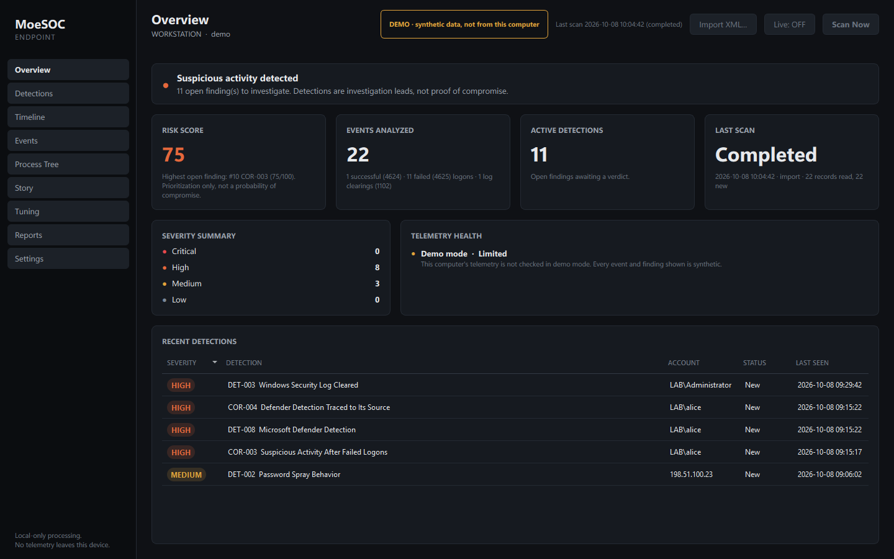
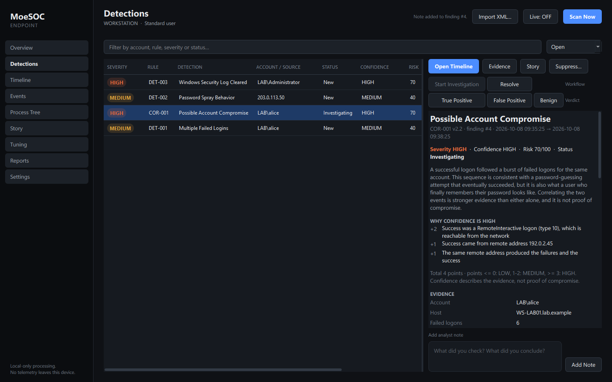
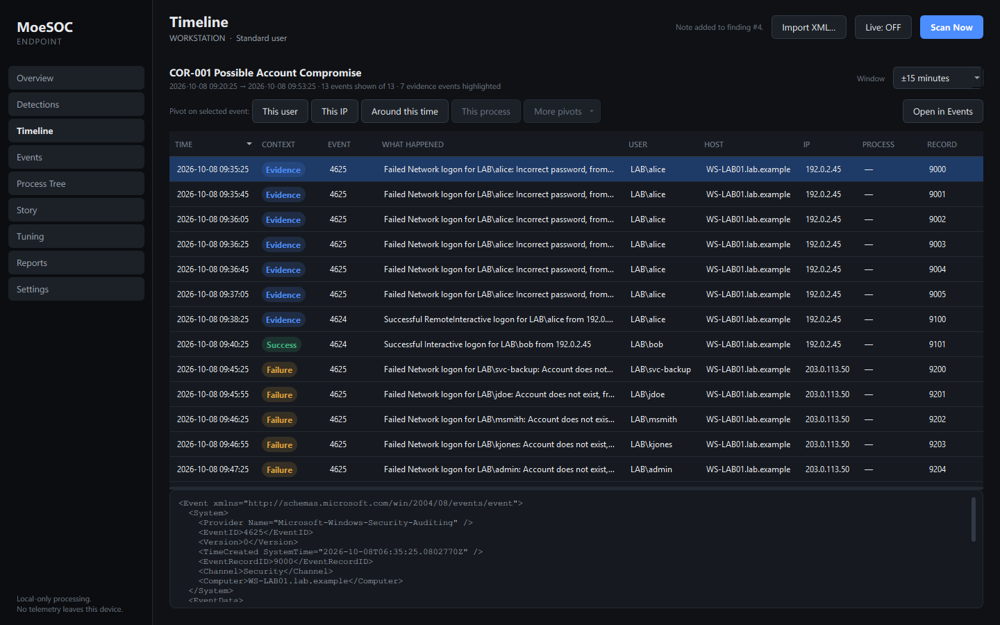
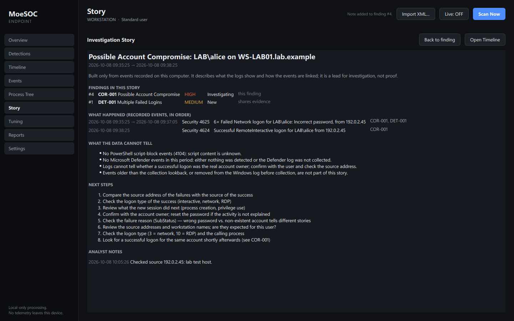
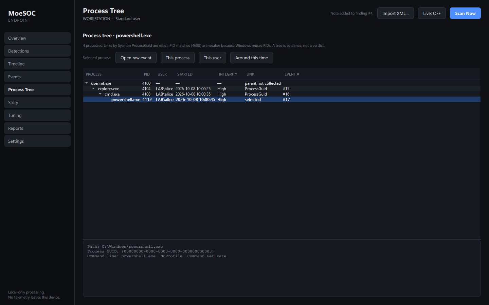
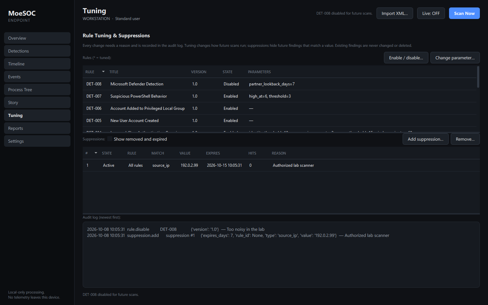

# MoeSOC Endpoint


**Always-on, local-first Windows detection and investigation platform.**

A small Windows service watches the Windows event logs and turns selected security events into explainable findings. Important findings raise a Windows notification. Clicking it opens an investigation console with the evidence, a timeline, a story and the triage workflow. Everything stays on the computer.

> **Version 1.1.0.** A single-endpoint portfolio project, validated on a real Windows 11 PC. It is **not** an antivirus, a full EDR/XDR or an enterprise SIEM: it observes, explains and helps you investigate; it never blocks, kills, quarantines or changes the system.

| | |
|---|---|
| Platform | Windows 10/11 x64 |
| Language | Python 3.12+ (built and tested on 3.13) |
| UI | PySide6 / Qt 6 console; native Windows tray |
| Telemetry access | Windows Event Log API via pywin32 (`EvtQuery`, `EvtSubscribe`, `EvtRender`) |
| Storage | Local SQLite (WAL), schema v9 with transactional migrations |
| Network | **None.** No telemetry upload, no TCP/UDP listener. |
| License | [MIT](LICENSE) |

## What Problem It Solves

Windows records a lot of security telemetry: logons and failures, account and group changes, PowerShell script blocks, Microsoft Defender detections and, with Sysmon, process, file, registry, DNS and network activity. Read raw, this is thousands of loosely connected records, and the few that matter, such as a burst of failed logons followed by a success, are easy to miss.

MoeSOC collects a focused subset of that telemetry. It links related events across logs and logon sessions, and turns them into a small number of **findings**. Each finding explains which events produced it, how confident the evidence is and why it got its risk score. Every finding is an investigation lead, **not proof of compromise**.

## What MoeSOC Does

```
Windows telemetry  →  normalization  →  detection  →  correlation
      →  risk / confidence  →  notification  →  investigation
```

1. **Collect.** The sensor service subscribes to the Security, PowerShell, Defender and (if installed) Sysmon logs. After every start or wake-up it catches up incrementally, so nothing is read twice or skipped silently.
2. **Normalize.** Each event is parsed defensively (fields by name, one bad record never stops processing) into one common event model. The raw XML is kept as evidence.
3. **Detect.** Eight detection rules look for specific behaviour, each with documented thresholds and MITRE ATT&CK context.
4. **Correlate.** Four correlation rules link findings and events by identity, logon session, process GUID, file path or Defender detection ID, for example failed logons → success → activity in that session.
5. **Score.** Each finding gets a severity, an evidence-based confidence and a 0–100 risk score. Every modifier is listed with its reason.
6. **Notify.** HIGH and CRITICAL findings (configurable) raise a Windows notification, once per finding, with cooldown and pause.
7. **Investigate.** The console shows the finding, the evidence events, a timeline, process trees, an investigation story, triage, notes, verdicts and HTML reports.

## Key Features

**Always-on sensor**
- Lightweight **MoeSOC Sensor** Windows service: virtual service account, one privilege, delayed automatic start, restart on failure.
- Live event subscriptions with catch-up after reboot and sleep/resume.
- **MoeSOC Tray** for the signed-in user: status, notifications, recent finding, pause, notification settings.
- Clicking a **Windows notification** opens the matching finding; an open console is reused, never duplicated.
- **Finding-based notification deduplication:** raw events never notify. A finding notifies once; it notifies again only if its severity escalates, or its risk grows materially after a cooldown. A growing burst stays one finding. The state persists across restarts.

**Telemetry**
- Live Windows **Security** log: logons, failed logons, privileged sessions, account creation, group changes, log clearing, process creation when audited.
- **PowerShell** script-block logging (4104).
- **Microsoft Defender** detections and remediation results (1116–1119).
- **Sysmon** process, network, file, registry and DNS events, **when Sysmon is already installed** (MoeSOC never installs it).

**Detection and context**
- **8 detection rules** and **4 correlation rules** (listed below).
- Severity, evidence-based **confidence** and an explainable **risk score**.
- **MITRE ATT&CK** technique context per rule.
- Identity-correct matching (SID first; `CORP\admin` and `PC01\admin` are never merged).

**Investigation**
- **Evidence** drill-down to the exact events and their raw XML, with re-verification against the live log.
- **Timeline** around a finding, with the evidence highlighted.
- **Process trees** (Sysmon process GUIDs, or 4688 with PID-reuse protection).
- **Investigation stories:** a finding and its related findings as one narrative, including what the data *cannot* tell.
- **Triage**, **analyst notes** and **verdicts** (true positive, false positive, benign) with a full history.
- Search and pivots on every collected field.
- Self-contained **HTML reports** with optional consistent redaction.

**Operations**
- **Tuning and suppressions** with a required reason and an audit log; existing findings never change.
- Retention for MoeSOC's own data (Windows logs are never touched).
- A **CLI** for every feature.
- **Local SQLite storage**; **no cloud telemetry upload**; **no TCP/UDP listener**. The only IPC is a local named pipe.

## Architecture

```
            Windows Event Logs
   (Security · PowerShell · Defender · Sysmon*)
                     |
                     v
   +--------------------------------------+
   |  MoeSOC Sensor  (Windows service)    |
   |  subscribe / catch up                |
   |      -> normalize -> store           |
   |      -> detection + correlation  ----+----> SQLite  (C:\ProgramData\MoeSOC\data)
   |      -> risk / confidence            |          ^ read-only for normal users
   +------------------+-------------------+          |
                      |                              |
                      |  finding                     |
                      v  (local named pipe)          |
   +--------------------------------------+          |
   |  MoeSOC Tray  (signed-in user)       |          |
   |  status · Windows notification       |          |
   +------------------+-------------------+          |
                      |  click -> --finding N        |
                      v                              |
   +--------------------------------------+          |
   |  MoeSOC Console  (signed-in user)    |----------+
   |  evidence · timeline · story ·       |
   |  triage · notes · reports            |
   +--------------------------------------+
                                     * only if Sysmon is installed
```

Three processes, separated by privilege:

| Process | Runs as | Role |
|---|---|---|
| **Sensor** (`MoeSOCSensor.exe`) | `NT SERVICE\MoeSOCSensor` (virtual account, member of Event Log Readers, only `SeChangeNotifyPrivilege`) | The only collector and the main writer of the database. Runs without anyone signed in. |
| **Tray** (`MoeSOCTray.exe`) | The signed-in user, not elevated | Status icon, notifications, recent finding, settings. Starts at sign-in. |
| **Console** (`MoeSOC.exe`) | The signed-in user, not elevated (no UAC prompt while the sensor is installed) | Investigation UI. Reads the sensor's database read-only; triage, notes and verdicts are sent to the sensor over the pipe. |

The tray and console talk to the sensor over **one local named pipe** (`\\.\pipe\MoeSOC.Sensor`). Network clients are explicitly denied, the protocol is a short list of JSON commands, and the client checks that the server really is the service. Details: [docs/ALWAYS_ON_ARCHITECTURE.md](docs/ALWAYS_ON_ARCHITECTURE.md) and [docs/architecture.md](docs/architecture.md).

The console also works **without** the sensor, as a standalone scanner (it then asks for administrator rights to read the Security log).

## Example Detection Flow

This is an **authorized lab test** on the validation PC: wrong passwords typed at the lock screen of the owner's own account, then a normal sign-in.

```
7 × Event 4625 (failed logon, same account)        Windows writes them
1 × Event 4624 (successful logon)
        |
        v   received live by the sensor (no manual scan)
DET-001 Multiple Failed Logins          MEDIUM   (recorded, no notification)
COR-001 Possible Account Compromise     HIGH     risk 70, 9 evidence events
        |
        v
1 Windows notification  ->  click  ->  console opens finding #2
        |
        v
Analyst: evidence (the 4625/4624 events) · timeline · story
         -> verdict "Benign" (authorized test) + note
```

COR-001 means the *pattern* fits password guessing that eventually succeeded. It is equally what a user who finally remembers their password looks like. The finding explains this and asks the analyst to confirm. It is not proof of compromise.

## Validation

Validated on **one real Windows 11 PC** (build 26200, 16 logical CPUs) with the packaged build. Full evidence: [docs/MoeSOC_AlwaysOn_Final_Report.md](docs/MoeSOC_AlwaysOn_Final_Report.md).

**Automated (final code)**

| Suite | Result |
|---|---|
| Windows pytest, elevated | **672 passed**, 0 failed, 1 skipped |
| Windows pytest, non-elevated | **671 passed**, 0 failed, 2 skipped |
| Linux pytest | **670 passed**, 0 failed, 3 skipped |
| GUI smoke test (drives the real window) | **76 / 76** |
| Ruff lint and format | clean |
| Packaged executable self-test | PASSED |

Skipped tests are platform- or privilege-specific: Windows-only tests on Linux, elevation-only tests when not elevated, and a POSIX-permission test on Windows.

**Real Windows, with the packaged sensor, tray and console**

| Scenario | Result |
|---|---|
| Live delivery: real failed logons received **without Scan Now** | passed |
| Real notification: exactly **one** toast for the COR-001 finding | passed |
| Notification click / deep link opens the right finding; the console is reused, not duplicated | passed |
| Normal-user console: all pages, evidence, story, reports; triage, note and verdict saved through the sensor | passed |
| Reboot: sensor starts automatically, tray reconnects, console does not auto-start | passed |
| Sleep / resume: catch-up, subscriptions recovered, IPC alive | passed |
| Update with rollback: locked folder → previous version kept and restarted | passed |
| Uninstall / reinstall: service removed, data kept, old findings readable again | passed (after fixing one reinstall timing bug found by this test) |
| Database persistence: `PRAGMA quick_check` | **ok**, **0** duplicate events, analyst data intact across every step |
| Network exposure | 0 TCP / 0 UDP sockets from any MoeSOC process |

**Idle resource use** (10 minutes, performance counters, CPU normalised to 16 logical CPUs)

| Process | CPU (average) | Working set |
|---|---|---|
| Sensor | ≈ **0.009 %** | ≈ **37 MB** |
| Tray | ≈ 0.0002 % | ≈ **33 MB** |

**Limitations of this validation:**
- It is one PC, one person, one day of focused testing.
- The "normal user" tests used the signed-in account without elevation (the filtered UAC token), not a separate standard account.
- Sysmon was **not installed** and process-creation auditing was **off** on the validation PC.
- Resource figures are from that PC only.

## Security Model

- **Local-first.** Events, findings and notes stay in a local SQLite database. No cloud, no telemetry upload, no account, no update check.
- **Least-privilege sensor.** It runs as a virtual service account with read access to event logs and nothing else. It is not LocalSystem.
- **Normal-user tray and console.** Investigation needs no administrator rights. Changing what is detected or kept (suppressions, rule changes, retention) deliberately needs an administrator console.
- **Named-pipe IPC only.** It has an explicit access list:
  - Network logons are denied, and remote clients are rejected.
  - Users cannot create a rogue pipe instance.
  - Messages are size-limited JSON from a fixed command list.
  - The client verifies the server.
- **Protected state.** `C:\ProgramData\MoeSOC` is owned by Administrators. The service can modify it; users can only read it. The program folder lives under `Program Files`.
- **No remote shell, no command execution.** Nothing in the protocol runs commands, touches arbitrary files or the registry, or sends raw event content.
- **No automatic remediation.** MoeSOC never blocks, kills, quarantines, changes audit policy, installs Sysmon or clears a log. Defender verdicts are attributed to Microsoft Defender.
- **Sensitive content stays local.** Command lines and script text are kept only in local raw evidence, never in summaries, notifications, logs or reports.

## Supported Telemetry

| Source | Events | Status on the validation PC |
|---|---|---|
| Security | 4624, 4625, 4672 | **REAL VALIDATED**: live delivery, DET-001 and COR-001 on real events |
| Security | 1102, 4720, 4732 | **PARTIALLY VALIDATED**: parsed and collected; detections proven on synthetic events |
| Security | 4688 process creation | **SYNTHETIC ONLY**: process-creation auditing was off on the validation PC |
| PowerShell | 4104 script blocks | **PARTIALLY VALIDATED**: real events collected live; DET-007 positives synthetic only (Script Block Logging policy not enabled) |
| Microsoft Defender | 1116–1119 | **PARTIALLY VALIDATED**: live subscription verified; no real detection occurred; DET-008 / COR-004 synthetic only |
| Sysmon | 1, 3, 11, 13, 22 | **SYNTHETIC ONLY**: Sysmon was **not installed** on the validation PC; correctly reported as "not installed" |

## Detection Coverage

| ID | Detection | MITRE ATT&CK |
|---|---|---|
| DET-001 | Multiple failed logins for one identity (≥ 5 in 5 min) | T1110 |
| DET-002 | Password spray: one source, many identities | T1110.003 |
| DET-003 | Security log cleared (1102) | T1070.001 |
| DET-004 | Low-and-slow password guessing over 60 min | T1110, T1110.001 |
| DET-005 | New local user account (4720) | T1136.001 |
| DET-006 | Member added to a privileged local group (by well-known SID) | T1098.007 |
| DET-007 | Suspicious PowerShell script block (explainable indicator score) | T1059.001 |
| DET-008 | Microsoft Defender detection, with Defender's remediation result | — (Defender's verdict) |

| ID | Correlation | MITRE ATT&CK |
|---|---|---|
| COR-001 | Possible account compromise: failed logons, then a success | T1110, T1078 |
| COR-002 | New account added to Administrators | T1136.001, T1098.007 |
| COR-003 | Suspicious activity in the session opened after failed logons | T1110, T1078 |
| COR-004 | Defender detection traced to the process that wrote the file | T1105, T1204.002 |

Thresholds, evidence and confidence rules: [docs/detections.md](docs/detections.md).

## Limitations

- **Single Windows endpoint.** There is no fleet management and no central server.
- **Not an antivirus**, and not a full enterprise EDR, XDR or SIEM. It has no kernel sensor and no file scanning.
- **No automatic containment or response.** MoeSOC only observes and explains.
- **Sysmon must already be installed** for Sysmon telemetry. PowerShell coverage is best with Script Block Logging, and 4688 needs process-creation auditing. MoeSOC reports what is missing but never changes it.
- **Some detection positives are synthetic-only** (see the table above). Real positives exist for DET-001 and COR-001.
- **Binaries are not code-signed**, so SmartScreen warns on first run. There is no installer: the release is a portable folder (see below).
- **Known low-severity items:**
  - Detection cost during large live bursts.
  - A missing optional Sysmon log is logged at ERROR level on each start.
  - Uninstall leaves an already running tray open until sign-out.
  - "Resume from sleep" can be logged twice.

  See [docs/known_issues.md](docs/known_issues.md).

## Screenshots

All screenshots are from **synthetic** test data: fictional accounts and RFC 5737 documentation addresses. The computer name is replaced with `WORKSTATION`. See [docs/SCREENSHOT_PLAN.md](docs/SCREENSHOT_PLAN.md).

| Overview (demo data) | COR-001 detail: confidence and risk explained |
|---|---|
|  |  |
| **Timeline with evidence highlighted** | **Investigation story** |
|  |  |
| **Process tree** | **Tuning and audit log** |
|  |  |

A screenshot of the tray notification is planned (manual capture).

## Installation / Running

There is **no installer**. The release is a portable folder (`MoeSOC-Endpoint-v1.1.0-win-x64.zip`) with three executables that share one runtime.

**1. Unpack** the zip, for example to `C:\Tools\MoeSOC`. Verify it against `SHA256SUMS.txt` first:

```powershell
Get-FileHash .\MoeSOC-Endpoint-v1.1.0-win-x64.zip -Algorithm SHA256
```

**2a. Console only (no service).** Run `MoeSOC.exe`. Without the sensor it asks for administrator rights, because reading the Security log needs them. Use **Scan Now** to analyze recent events.

**2b. Always-on (recommended).** From an **administrator** Command Prompt in the unpacked folder:

```powershell
MoeSOCSensor.exe install --copy-to-program-files
```

This:
- copies the program to `C:\Program Files\MoeSOC Endpoint`;
- registers and starts the **MoeSOC Sensor** service;
- creates `C:\ProgramData\MoeSOC` with protected access rights;
- adds the tray to your sign-in.

From then on, open MoeSOC from the tray or the notification, as a normal user.

Re-running the same command with a newer build updates in place. If anything fails, the update rolls back to the previous version.

```powershell
"C:\Program Files\MoeSOC Endpoint\MoeSOCSensor.exe" status      # state, channels, database
"C:\Program Files\MoeSOC Endpoint\MoeSOCSensor.exe" uninstall   # removes the service; KEEPS C:\ProgramData\MoeSOC\data
```

**Optional telemetry** (your decision; MoeSOC never changes it): [Sysmon](docs/sysmon.md), PowerShell Script Block Logging and process-creation auditing ([docs/detections.md](docs/detections.md)).

**Demo without touching your logs:** `scripts\demo.bat` (from source) opens a clearly labelled synthetic attack story in a separate database. See [docs/demo.md](docs/demo.md).

## Development / Tests

```powershell
git clone <repository-url> moesoc
cd moesoc
py -3.13 -m venv .venv
.\.venv\Scripts\python.exe -m pip install -r requirements-dev.txt

.\.venv\Scripts\python.exe -m pytest -q          # tests
.\.venv\Scripts\python.exe -m ruff check .       # lint
.\.venv\Scripts\python.exe -m ruff format --check .
.\.venv\Scripts\python.exe scripts\gui_smoke.py  # GUI smoke test (synthetic data, throwaway folder)
.\.venv\Scripts\python.exe app.py                # run the console from source

scripts\verify_windows.bat     # all of the above + CLI checks, output in verify_output.txt
scripts\build_installer.bat    # PyInstaller build to dist\MoeSOC + MoeSOC.exe --self-test
dist\MoeSOC\MoeSOC.exe --self-test   # writes %LOCALAPPDATA%\MoeSOC\logs\self-test.txt
```

On Linux, the parsers, rules, storage, IPC protocol and tray logic are tested with fakes (`python -m pytest`). The Windows-only parts are skipped.

**CLI** (from source; `--data-dir` selects another database):

```powershell
python -m moesoc.cli health
python -m moesoc.cli scan
python -m moesoc.cli detections --all
python -m moesoc.cli show 2
python -m moesoc.cli story 2
python -m moesoc.cli triage 2 INVESTIGATING --note "asked the user"
python -m moesoc.cli events --user alice --event-id 4625 --since-hours 2
python -m moesoc.cli report --finding 2 --out finding2.html --redact
```

More: [Testing](docs/testing.md) · [Validation](docs/validation.md) · [Packaging](docs/packaging.md) · [CI](docs/ci.md) · [Benchmarks](docs/benchmarks.md) · [Architecture](docs/architecture.md) · [Changelog](CHANGELOG.md) · [Release notes v1.1.0](RELEASE_NOTES_v1.1.0.md)

## License

MIT. See [LICENSE](LICENSE).
