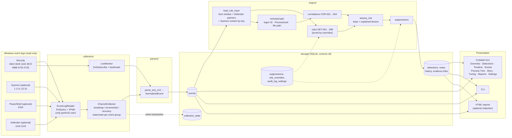

# Architecture

MoeSOC is one local process: collectors read Windows event logs, parsers normalize
them, SQLite stores them, the engine runs rules and correlations over the stored
events, and the GUI and CLI present the results. Nothing leaves the computer.

## Data flow

`engine/scanner.py::ScanService` owns this sequence (scan, import and live batches). The
GUI and the CLI both call it, so there is exactly one pipeline.

## Package layout

| Package | Responsibility |
|---|---|
| `core/` | Data model (`NormalizedEvent`, `Detection`, `RuleMetadata`), account identity and domain aliases, enums, exceptions, config |
| `collectors/` | Reading Windows logs: the pywin32 reader, the generic incremental `ChannelCollector` (Security, Sysmon, PowerShell, Defender groups), live subscriptions, Sysmon and PowerShell-policy probes, host info |
| `parsers/` | Rendered XML → `NormalizedEvent`, one module per log, `dispatch.parse_any_xml` routes by channel |
| `engine/` | Rules (`rules.py`, `account_rules.py`, `powershell_rules.py`, `defender_rules.py`), correlations (`correlation.py`, `cross_source.py`), the cross-source `ActivityGraph`, risk model, scan orchestration, live monitor, evidence verification |
| `storage/` | Schema and migrations, repositories, event search and pivots, timelines, process trees, investigation stories, HTML reports, retention, tuning and suppressions, enrichment queries, dashboard read model |
| `gui/` | PySide6 presentation only; every database or Windows call runs on a worker thread |
| `utils/` | Logging, privilege checks, time helpers |
| `health.py` | Read-only telemetry availability checks |
| `cli.py` | Every feature from the command line (scan, search, story, report, tuning, retention, verification) |

The GUI contains no detection logic. Everything it shows comes from tested, Qt-free
functions in `storage/` and `engine/`, which is what makes "no fake data" verifiable.

## Key design decisions

- **Server-side filtering.** XPath limits Windows to the event IDs, and to records after the saved position, so the full log is never loaded.
- **Incremental, gap-aware collection.** A watermark (record ID, timestamp, event-ID signature) per channel and event group is saved in the same transaction as the events. A cleared or rolled-over log is detected and reported ([collection.md](collection.md)).
- **Optional sources degrade gracefully.** A missing Sysmon, PowerShell or Defender log is recorded as "not installed"; the Security log is the only required source.
- **Detection over stored events.** Rules read the database, not just the current batch, so attacks spanning two scans are still found. The look-back is computed from each rule's own windows.
- **Context by key, not by volume.** Sysmon file/network/DNS events are not loaded into every rule run; COR-004 fetches them by the file path Defender named and the writer's ProcessGuid.
- **Explainable everything.** Each finding stores why: confidence factors, risk factors, link kinds in cross-source chains, tuning values. Severity, confidence and risk are separate concepts.
- **Idempotent ingestion and findings.** Unique key `(hostname, channel, record_id, timestamp)` for events; `dedup_key` per finding (rule + host + anchor record, or the Defender Detection ID). Rescans refresh evidence but never analyst status, verdict or notes; findings from an older `rule_version` are left untouched.
- **Rules as YAML metadata + Python logic.** Wording, thresholds and MITRE mappings are data; matching logic is code with tests. Analysts tune through audited database overrides, never by editing YAML.
- **Privacy.** Command lines and script text are stored locally (raw evidence) but never copied into summaries, stories, reports or logs. Reports can redact identities.
- **Threading.** Each kind of background work has its own `TaskRunner` (`QThread` + worker); results arrive as queued signals on the GUI thread; every thread uses its own SQLite connection (WAL mode). Live monitoring has a dedicated thread.
- **Errors.** Windows error codes become readable `MoeSOCError` messages (e.g. access denied → run as administrator); technical detail goes to the rotating diagnostic log.

## Database (schema v8)

| Table | Purpose | Since |
|---|---|---|
| `events` | Normalized events + raw XML; identity, logon, process (PID, GUIDs, parent, command line, integrity), network (both endpoints, protocol), file, registry, DNS, group membership, privileges, `details` JSON | v1, extended in v2, v3, v5 |
| `scans` | One row per scan or import, including failures and the collection mode | v1, v4 |
| `collection_state` | Watermark per channel and event group | v4 |
| `detections` | Findings with severity, confidence, risk, evidence JSON, triage status, verdict, rule version | v1, v2 |
| `detection_events` | Evidence links finding → stored events | v2 |
| `detection_notes`, `detection_history` | Analyst notes; audit trail of status changes | v2 |
| `settings` | Local settings stored with the data (retention period) | v7 |
| `suppressions` | Auditable suppressions (never hard-deleted), hit counts | v8 |
| `rule_overrides` | Rule enable/disable and tuned integer parameters | v8 |
| `audit_log` | Every tuning change with its reason | v8 |

Indexes added in v6 serve the cross-source lookups and pivots (file path and process path case-insensitive, destination IP, DNS name). Every migration is a Python function run in one transaction; a failure rolls back completely, and a database from a newer version is refused, never downgraded. The real development database was migrated v5 → v8 in place during the October 2026 checkpoints without losing events.

## Investigation features

- **Search** (`storage/event_search.py`): every `EventFilter` field becomes a parameterized SQL condition (time, IDs, source, provider, host, user, domain, SID, IP, port, logon type and session, process, parent, file, registry, DNS, Defender threat, free text); LIKE input is escaped; results are paginated with an exact total. `more_pivots()` derives pivots from whatever an event recorded.
- **Timelines**: a finding's host events with padding, evidence highlighted; pivot timelines for any filter.
- **Process trees** (`storage/process_tree.py`): Sysmon GUID links (exact) and 4688 PID links (PID-reuse aware), with limits and cycle protection.
- **Stories** (`storage/story.py`): a finding, related findings (shared evidence or same account/time), collapsed steps, data gaps, next steps, notes — built on demand, never cached.
- **Reports** (`storage/report.py`): self-contained HTML from the story or the endpoint summary; inline CSS only; optional consistent redaction.

## Extending

**A new rule on an existing log**

1. Map any new fields in the log's parser (`parsers/security.py`, `sysmon.py`, …); add the event ID to its enum so it is collected.
2. Add `rules/<area>/DET-xxx-name.yaml` with `version`, description, MITRE, false positives, recommended investigation, parameters.
3. Write the detection function (signature `(events, rule, context=None) -> list[Detection]`) and register it in `scanner.RULE_FUNCTIONS`. If it reads an event ID not yet in `RULE_INPUT_EVENT_IDS`, add it there.
4. Add sanitized fixtures and positive, negative, boundary, missing-field and out-of-order tests. Integer parameters become tunable automatically; a test fails if one is never read.

**A new log**

1. A parser with a `normalize_<log>_event(raw)` function, routed in `parsers/dispatch.py`.
2. A `ChannelCollector` subclass with its event groups; add it to `OPTIONAL_SOURCES` and to the live-ingest group map in `scanner.py`.
3. A health check entry in `health.py`, explain/badge text in `event_search.py`, and an Events outcome label.
