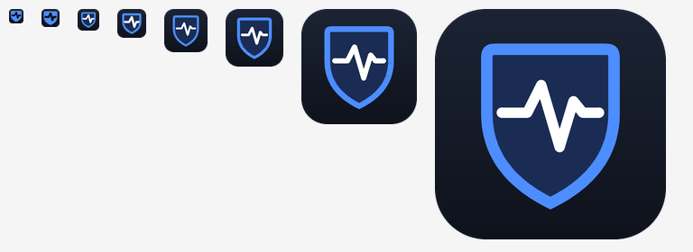
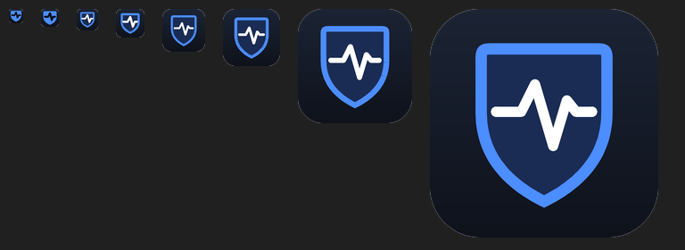

# Branding: the MoeSOC icon

**Design.** A dark rounded tile, a heater shield outlined in the app's accent blue (`#4C8DFF`) on a deep-blue field (`#1A2C54`), and a white detection pulse across it: *protection* plus *monitoring*. It is original artwork drawn from geometry by `scripts/make_icon.py` — no stock images, fonts or third-party marks — so it can be regenerated, changed and reviewed like code.

**Small sizes.** Each size is drawn separately at 8× and downsampled. At 16 and 20 px the shield is solid blue with a dark pulse cut through it; at 24 and 32 px the outline and pulse are heavier. This keeps the mark readable in the taskbar, Alt+Tab and Explorer's small icons.

**Files.**

| File | Use |
|---|---|
| `assets/icons/MoeSOC.ico` | Windows icon with 16, 20, 24, 32, 40, 48, 64, 128 and 256 px images: window and taskbar (via `app.py`), Desktop shortcut (`launcher/create_shortcut.ps1` picks it up automatically), installer and executable |
| `assets/icons/MoeSOC-256.png` | README, release page |

**Taskbar.** `app.py` sets an explicit AppUserModelID (`MoeSOC.Endpoint`), so Windows groups the window under the MoeSOC icon instead of `python.exe`'s.

**Regenerate:** `python scripts/make_icon.py` (needs Pillow, a development dependency only).
