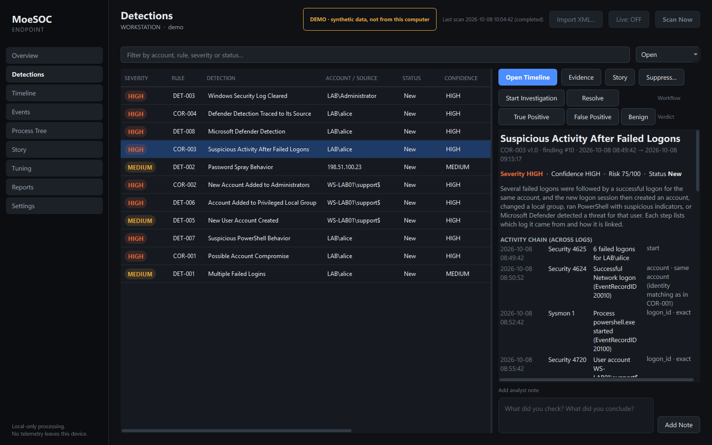
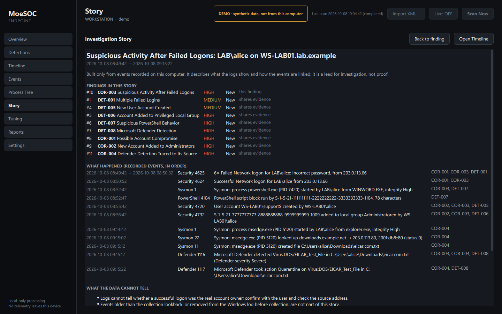
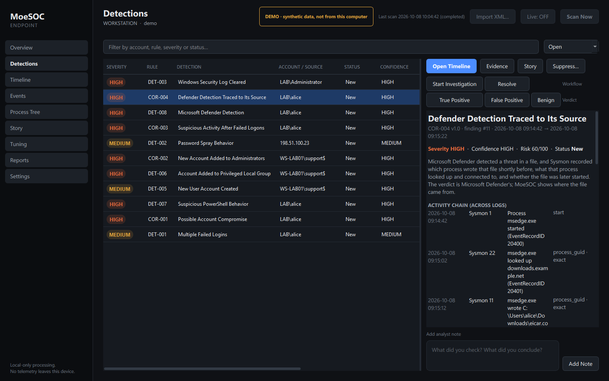
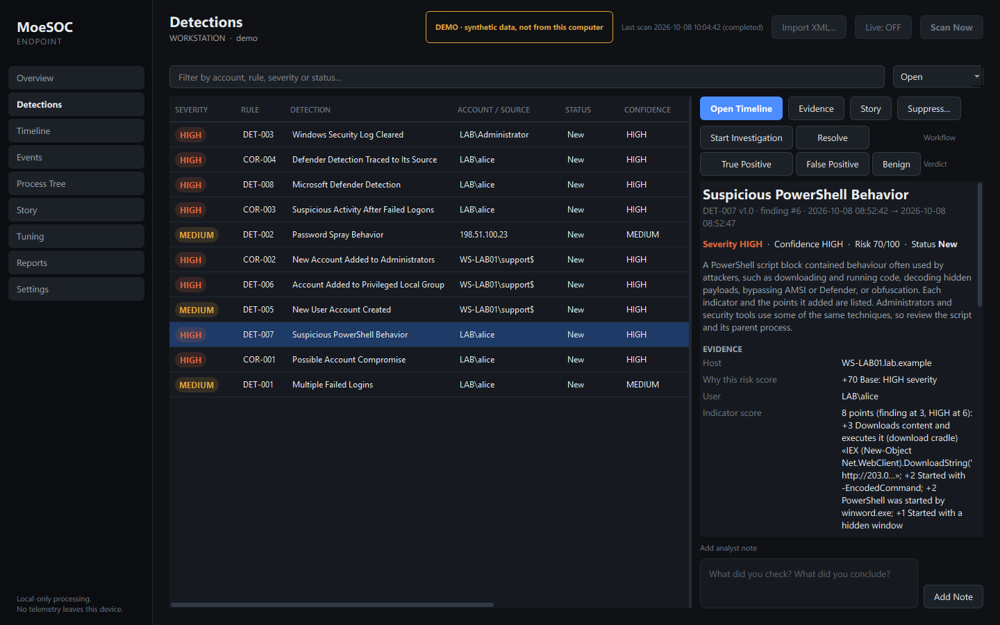

# Portfolio demo (5 minutes)

The demo runs MoeSOC on a **synthetic attack story** in its own database. Nothing in it
comes from your computer: the window title and a badge say **DEMO · synthetic data**,
Health is not checked, and Scan, Live and Import are disabled so real telemetry can never
be mixed in.

```powershell
scripts\demo.bat                 # build the demo database and open MoeSOC in demo mode
python scripts/demo.py --no-gui  # same data, printed findings only
```

The data goes to `%LOCALAPPDATA%\MoeSOC-Demo` (a marker file protects any other database
from being replaced). It is built by the normal import pipeline from fixture-based events:
fictional accounts on `WS-LAB01.lab.example`, RFC 5737 documentation addresses, the
harmless EICAR test file.

## The story

1. Six failed network logons for `LAB\alice` from 203.0.113.66, then a successful one.
2. In **that logon session**: Word starts PowerShell with `-EncodedCommand` and a hidden window; the script block is a download cradle. A hidden account `support$` is created and added to Administrators.
3. A password spray from 198.51.100.23 against five accounts.
4. A browser downloads the EICAR test file; Microsoft Defender detects and quarantines it; Sysmon recorded the DNS lookup and the file write.
5. The Security log is cleared.

Eleven of the twelve rules fire (DET-004 needs an hour of slow guessing, which is not part of this short story).

## Walkthrough

**1. Overview** — the risk score names the finding behind it (COR-003, 75/100) and says it is prioritization, not probability. Health shows the demo notice instead of this PC's status.


**2. COR-003, the cross-source chain** — failures → logon → PowerShell → new account, each step with its log, record ID and link (`logon_id · exact`). Point out that the Defender detection is linked more weakly (same user, close in time) and the finding says so.



**3. The story** — one narrative across nine related findings, repeated events collapsed, what the data cannot tell, and next steps. No command lines or script text appear in it.



**4. COR-004, Defender traced to its source** — "Microsoft Defender detected…", the browser that wrote the file, its DNS lookup, remediation succeeded (risk −15), corroborated by two logs (+5).



**5. DET-007, explainable PowerShell scoring** — every indicator with its points and a short excerpt (the full script stays in the local raw event): download cradle +3, encoded command +2, Word as parent +2, hidden window +1 = 8 points, HIGH at 6.



**Then, live in the app:** export the COR-003 report with **Redact** on (alice becomes `USER-1` everywhere, addresses become `IP-n`), suppress the spray source with a reason and show the audit log, and open the process tree of the PowerShell event.

## Talking points

- Explainability over magic: every severity, confidence and risk value has written reasons.
- Exact links over time guesses: logon IDs, ProcessGuids, file paths, Defender Detection IDs; weaker links are labelled.
- Safety: read-only, local, no response actions, Defender's verdict attributed to Defender, no secrets in summaries.
- Engineering: 452 tests, a 76-check GUI smoke test on Windows at every checkpoint (it found real bugs), measured benchmarks, packaged executable with a self-test.
